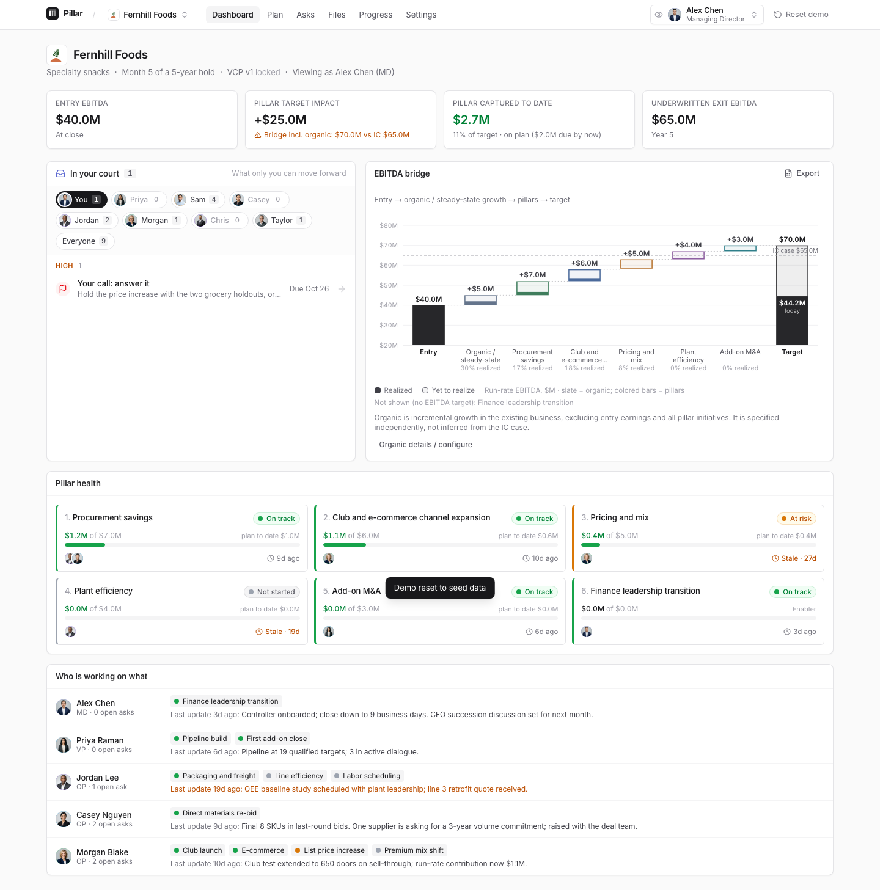
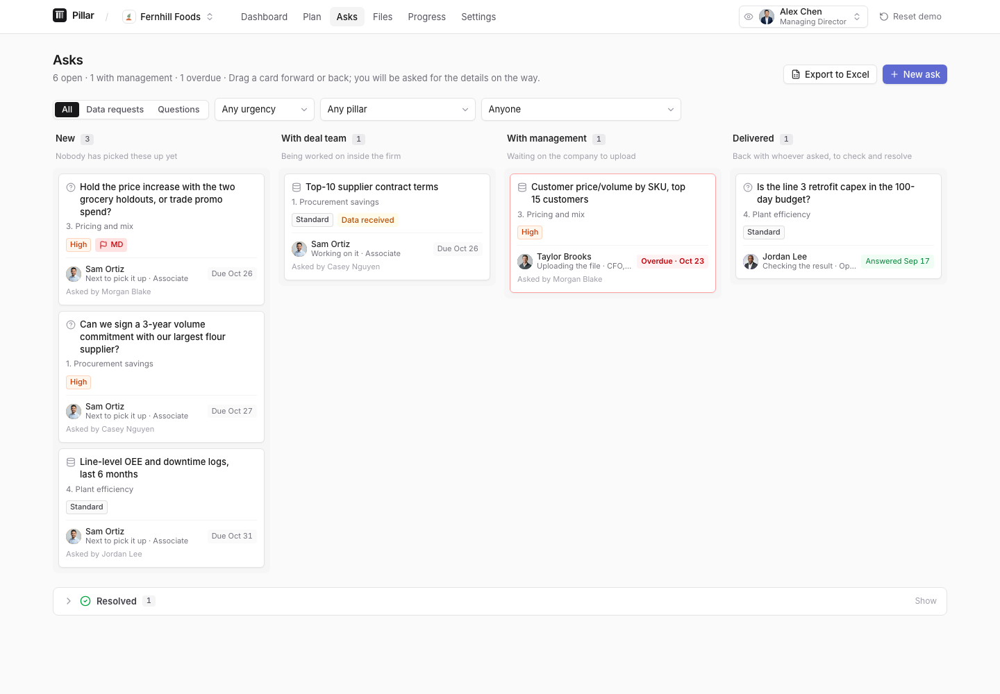

# Pillar

**Portfolio company operations and value creation, in one workspace.**

[**Open the live demo**](https://pillar-oct-26-hackathon.replit.app) · [Download the source ZIP](https://github.com/miyainai/Pillar/archive/refs/heads/main.zip) · [Product debrief](docs/Pillar-Debrief.md)

Built by Miya, Mihir, and Aaron for a Replit hackathon. We all worked in private equity and saw the same problem: updates scattered across emails, spreadsheets, and slide decks, with no shared view of what was moving or who needed to act.

Pillar connects a company's value creation plan to its owners, operating updates, financial targets, and data requests. Deal teams, operating partners, and company management each see a view suited to their role.

> **Hackathon prototype:** this is a working, browser-local demo with fictional data. The role switcher demonstrates workflows; it is not authentication or a production security boundary. Different browsers do not share changes.

## What you can explore

- **Plan:** initiatives, sub-initiatives, phases, owners, KPIs, and target versus captured run-rate EBITDA.
- **Dashboard:** plan health, work waiting on each person, and an EBITDA bridge.
- **Asks:** data requests and questions with owners, routing, deadlines, attachments, and a history of transitions.
- **Progress:** changes over time, comparison dates, and a printable board supplement.
- **Files:** uploads organized by workstream, with links back to their context.
- **Exports:** Excel workbooks with native charts linked to editable data.
- **Optional AI:** draft a plan from uploaded deal materials or help reword a management-facing request. Pre-generated fallbacks are labelled when AI is unavailable.

## Screenshots



<details>
<summary>Data requests and questions</summary>



</details>

## Download and run

You can clone this repository, or use **Code → Download ZIP** on GitHub and extract it. The repository includes source code, demo assets, tests, and dependency lockfile; it does not include installed dependencies or a prebuilt executable. Opening `index.html` directly will not run the app.

Use **Node.js 24** and **pnpm 11.25.0**. Run the following from the project root:

```sh
git clone https://github.com/miyainai/Pillar.git
cd Pillar
npm install --global pnpm@11.25.0
pnpm install --frozen-lockfile
pnpm dev
```

If you downloaded a ZIP, open a terminal in the extracted folder and start with the pnpm installation command. Open **http://localhost:5173** after both services start. `pnpm dev` launches the frontend and API; the frontend proxies `/api` to the API on port 8080. No database or AI key is needed to explore the seeded demo.

If either port is occupied, copy `.env.example` to `.env` and change `PILLAR_WEB_PORT` or `PILLAR_API_PORT`. The development launcher reads `.env`; keep that file out of Git.

### Try the demo

1. Open **Fernhill Foods** and view the dashboard as Alex, the MD.
2. Switch to an operating partner and post a progress update.
3. Open **Asks**, route a data request through Sam, and switch to Taylor to upload a response.
4. Return to **Progress** and compare dates; export a chart to Excel.
5. Open **Northgate Industrial Supply** to see a company behind plan.

**View as** changes personas. **Reset demo** restores sample data. Records are stored in localStorage and uploaded file bytes in IndexedDB in your browser. Clearing browser storage removes your local work. Seeded request attachments may download as labelled samples; original uploads retain their bytes.

### Optional AI

The API uses Anthropic. To enable it, copy `.env.example` to `.env`, set `ANTHROPIC_API_KEY` locally, and restart `pnpm dev`. The configured model and API options are in `artifacts/api-server/src/lib/pillar/_claude.ts`; availability depends on the provider account. Live provider calls were not verified during the GitHub portability cleanup.

AI is optional for the demo. Do not put API keys in frontend code or upload confidential deal materials to this public prototype.

## Deploy to Vercel

Import `miyainai/Pillar` from GitHub into Vercel. Keep **Root Directory** at the
repository root (`./`) and use **Node.js 24.x**. The checked-in `vercel.json`
sets the remaining options:

| Setting | Value |
| --- | --- |
| Framework preset | Other |
| Install command | `npx --yes pnpm@11.25.0 install --frozen-lockfile` |
| Build command | `npx --yes pnpm@11.25.0 run build` |
| Output directory | `artifacts/pillar/dist/public` |

The frontend and API deploy together. `/api/*` requests go to the Express
function, static assets are served directly, and other paths fall back to
`index.html` so refreshing a company page works. The API build exports an app
for Vercel and a separate listening server for local development and Replit.

No environment variables are required for the seeded demo. Leave
`ANTHROPIC_API_KEY` unset for the public demo; the app retains its labelled
fallbacks. Live AI still needs the access and usage controls described below.
Do not set `PORT`, `BASE_PATH`, or `PILLAR_API_URL` in Vercel.

After deployment, check the homepage, refresh a company page, and open
`/api/healthz` (expected: `{"status":"ok"}`). With no AI key configured,
`POST /api/generate` should return HTTP 503 and `{"error":"not_configured"}`.

See Vercel's [Vite deployment guide](https://vercel.com/docs/frameworks/frontend/vite)
and [Node.js functions guide](https://vercel.com/docs/functions/runtimes/node-js).

## Build and test

```sh
pnpm test                 # frontend unit tests
pnpm build                # frontend and API production bundles
pnpm typecheck            # separate strict TypeScript check
```

The frontend build is written to `artifacts/pillar/dist/public`; the API build is written to `artifacts/api-server/dist`. These generated directories are intentionally excluded from Git.

Browser checks require the app to be running and Playwright Chromium installed:

```sh
pnpm --filter @workspace/scripts exec playwright install chromium
```

On macOS/Linux, in a second terminal:

```sh
PILLAR_TEST_URL=http://localhost:5173 pnpm test:browser
```

In PowerShell:

```powershell
$env:PILLAR_TEST_URL = "http://localhost:5173"
pnpm test:browser
```

Additional browser scenarios are listed in `scripts/package.json`. See [validation notes](docs/VALIDATION.md) for the checks actually run during repository cleanup, including known failures.

## Architecture

| Location | Purpose |
| --- | --- |
| `artifacts/pillar/` | React, TypeScript, Vite frontend; demo assets and unit tests |
| `artifacts/api-server/` | Express API for generation, regeneration, and request wording |
| `lib/api-spec/` | OpenAPI contracts |
| `lib/api-client-react/`, `lib/api-zod/` | Generated API client and validation helpers |
| `lib/db/` | Database scaffolding; not the demo's persistence layer |
| `scripts/` | Local launcher and Playwright scenarios |
| `docs/` | Product debrief, technical limitations, and validation notes |
| `artifacts/mockup-sandbox/` | Original design scaffolding; not required to run Pillar |

The client uses a Zustand store, a central role projection (`projectView()`), and an activity log. Plan updates and request transitions write through the store so dashboards and history remain consistent. Uploaded documents are parsed in the browser; requesting AI generation sends extracted text to the server and provider.

## Prototype boundaries

- **No real authentication or server-enforced authorization.** The full demo state is available in the browser; role filtering demonstrates the intended UI only.
- **No shared multi-user database or cloud file storage.** Real collaboration requires backend persistence, authorization, and file access controls.
- **No verified financial attribution.** Captured EBITDA is entered by users; plan-to-date is a straight-line assumption, not an accounting reconciliation.
- **No public AI-service hardening.** Authentication, rate limits, and usage controls are needed before exposing funded AI endpoints to untrusted users.
- **GitHub hosts the source, not the running application.** Replit and Vercel deployment configurations are included. Other hosts need an SPA fallback to `index.html` and `/api` routing to Express. The [live demo](https://pillar-oct-26-hackathon.replit.app) is hosted separately on Replit.

## Project notes

- [Product and build debrief](docs/Pillar-Debrief.md) — the original October 25, 2026 handoff, preserved unchanged. Historical test and implementation claims in that document are separate from the current validation record.
- [Validation notes](docs/VALIDATION.md) — reproducibility checks and outstanding issues.
- [Dependency notes](docs/dependency-security.md) — original dependency review, where available; not a current security certification.
- [Replit notes](replit.md) — platform-specific setup and implementation context.

Licensed under the [MIT License](LICENSE).
